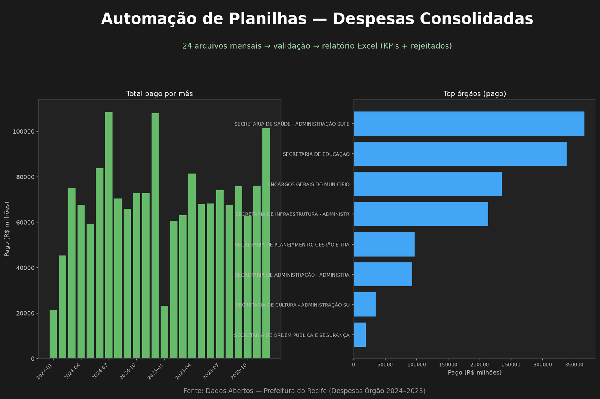

# Automação de Planilhas — Consolidação de Despesas Públicas

Script que lê **várias planilhas Excel** (exportações mensais), valida valores monetários, rejeita linhas inconsistentes com log, e gera um **relatório Excel formatado** com abas de KPIs, resumos e detalhe.

## Objetivo

Mostrar automação típica de operação: juntar arquivos espalhados, padronizar números no formato brasileiro, garantir qualidade e entregar um relatório pronto para gestão.

## Fonte de dados

Dados **reais e públicos** da Prefeitura do Recife (Portal de Dados Abertos):

- Conjunto: *Despesas Orçamentárias — Despesas Órgão* (2024 e 2025)
- Licença: Open Data Commons ODbL
- URLs dos CSV oficiais registradas em `dados_entrada/FONTE.txt`

O script `preparar_entradas.py` baixa os CSV e **divide por ano/mês** em vários `.xlsx`, simulando exportações operacionais de sistemas diferentes.

## Stack

- Python, pandas, openpyxl
- Entrada: múltiplos `.xlsx`
- Saída: relatório `.xlsx` com formatação + CSV de rejeitados

## Como rodar

```bash
python -m venv .venv
source .venv/bin/activate
pip install -r requirements.txt

# 1) Baixa o CSV público e gera as planilhas de entrada
python src/preparar_entradas.py

# 2) Consolida, valida e gera o relatório
python src/consolidar.py
```

Saídas em `output/`:

- `relatorio_despesas_consolidado.xlsx` — abas KPIs, Por_Mes, Por_Orgao, Por_Grupo, Detalhe, Rejeitados
- `rejeitados.csv` — log das linhas descartadas
- `resumo_por_mes.csv`

## Regras de validação

- Colunas mínimas obrigatórias (`Ano`, `Mês`, `Empenhado`, `Liquidado`, `Pago`)
- Conversão de números no padrão BR (`1.234.567,89`)
- Valores como `N/A`, vazio inválido ou texto não numérico → rejeição com motivo
- Relatório formata cabeçalhos, filtros e casas decimais

## Resultados

- Dezenas de arquivos mensais consolidados em um único workbook
- Totais de empenhado / liquidado / pago por mês, órgão e grupo de despesa
- Linhas problemáticas isoladas na aba **Rejeitados** (e no CSV)



## Autor

João Vitor — Engenharia de Software (UEM). SQL, Python (ETL/automação) e Power BI.
